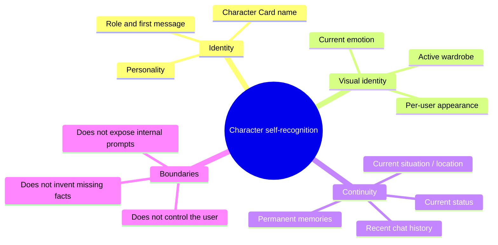

# RealmPlay Rules and Execution Visibility

## Rule inspection

`GET /api/rules` returns the named rules, their stage, description, and the
authenticated user's active/recent runs. `GET /api/activity` returns only the
execution runs. Both endpoints require the same login token as the chat.

| Rule | Stage | Current behaviour |
| --- | --- | --- |
| `system_instruction` | LLM | Character Card and isolated current state are assembled into the system instruction. |
| `language_adaptation` | LLM/TTS | Applies Thai or English response logic to all visible output: narration, dialogue, OOC, explanations, interjections, and speech synthesis text. |
| `self_recognition` | LLM | Gives the character a bounded inventory of identity, appearance, personality, memory, current situation/location, outfit, emotion, and recent context. |
| `non_literal_writing` | LLM | Keeps roleplay natural, progresses the scene, and prevents repeated assistant patterns. |
| `loop_guard` | LLM/output | Limits corrective generation to one retry, compares drafts with recent replies, and removes adjacent duplicate blocks. |
| `prohibitions` | LLM/output | Keeps hidden reasoning, system prompt text, fake tool results, and user-character control out of visible chat. |
| `pronoun` | LLM | Applies Thai relationship, hierarchy, and emotion-sensitive pronouns. |
| `expressive_vocalization` | LLM/TTS | Uses brief, character-appropriate interjections and vocal reactions only in fitting roleplay moments. |
| `proactive_state` | LLM | Saves canonical state blocks without displaying them in chat. |
| `image_trigger` | Image | Requires an explicit image request or image command. |
| `image_context` | Image | Sends scene/action, appearance, wardrobe, emotion, selected context, and configured suffix. |
| `wardrobe` | Image | Uses the active wardrobe selection. Automatic clothing changes are deliberately off. |
| `tts_dialogue` | TTS | Sends quoted dialogue, or supplied text when no dialogue exists. |
| `nsfw` | Policy | Does not inject undisclosed censorship; local model, workflow, and configured prompts remain authoritative. |

## Trace data

Each run has an ID, operation, phase, percentage, duration, active rules,
captured prompt payload, and error detail. Console messages use this form:

```text
[RealmPlay][image][a1b2c3d4] 55% ComfyUI: generating rules=image_context,wardrobe
```

The persistent activity log is `logs/rule-activity.log`.

Each completed trace also holds elapsed milliseconds plus best-effort RealmPlay
process RAM/CPU and NVIDIA VRAM snapshots at start/end. `GET /api/statistics`
returns per-user count, completed/error/cancelled totals, and average elapsed
time for chat, image, and TTS. These are snapshots, not p50/p95 benchmarks.

The in-app monitor polls `/api/activity` and shows a small progress bar while
chat, image generation, or TTS is running. It shows the last error after a
failure, so a failed ComfyUI/TTS call is visible without opening the console.

## Prompt trace rules

- The LLM trace holds the exact system instruction and message list sent to the
  built-in LLM.
- The Comfy trace holds the positive prompt, negative prompt, and image
  context passed to the workflow compiler.
- The TTS trace holds the extracted dialogue text that is sent to speech.
- Trace records are only visible to the authenticated user who started them;
  they are retained in memory as the latest 80 runs and are not written into
  chat history.

## Rule settings and safe automation

Rule Inspector can change these global local-server settings: proactive state,
loop/repetition guard, output prohibitions, explicit image trigger, automatic
wardrobe, prompt-trace retention, and NSFW
policy. The defaults preserve existing roleplay behaviour: proactive state and
explicit image requests are on; auto wardrobe is off; NSFW mode is `local`.

### Loop and output boundaries

`loop_guard` is enabled by default. It permits the LLM only one corrective
rewrite when its draft closely matches one of the recent assistant messages;
there is no open-ended regenerate loop. Consecutive identical blocks are
removed before the message is saved.

`prohibitions` is enabled by default. It instructs the LLM and filters visible
output so it does not expose `<think>` content, system/developer instructions,
tool-call markers, or a claim that image/audio generation succeeded before the
server has a result. The character must also not narrate the user's choices,
speech, thoughts, or feelings as facts.

### Expressive vocal reactions

`expressive_vocalization` is enabled by default and is configurable in Rule
Inspector. It permits short reactions such as a laugh, breath, sigh, gasp, sob,
or contextual interjection only when the immediate action and the character's
voice support it. The rule requires the reaction to stay inside quoted dialogue
so TTS can read it. It must not be inserted by default, repeated mechanically,
or used instead of meaningful dialogue.

## Language adaptation for all AI responses

The language rule has exactly two versions. The latest user message selects one:
Thai text triggers the **Thai** rule; otherwise the **English** rule is used.
It is not limited to vocal reactions. It controls all user-facing AI output:

- narration and actions
- spoken dialogue and TTS text
- OOC and concise explanations
- pronouns, politeness, sentence rhythm, punctuation, idiom, and interjections

Thai logic applies Thai pronoun/particle and cultural register rules. English
logic uses natural English register and explicitly avoids Thai particles or
literal Thai sentence structure. This rule applies only to text returned to the
user, including the text sent to TTS. It never translates or rewrites hidden
state blocks, saved memories, Character Card fields, ComfyUI prompts, workflow
data, or other internal context. Proper names, code, quotations, and explicit
translation requests remain exceptions.

## Image-request trigger formats

An image is created only when **Image trigger** is enabled and the latest user
message matches one of these formats. Character narration, memory, and hidden
model reasoning never call ComfyUI.

1. **Natural language**: phrases such as `สร้างรูป`, `ขอรูป`, `ถ่ายเซลฟี่`,
   `generate image`, or `send a photo`.
2. **Explicit command**: begins with `/image ` or `[[image: ...]]`. This is
   the clearest manual command and records `command` in the trace.

## Emotion prompt mapping

RealmPlay reuses Aurelia's visual-emotion mapping for the workflow emotion
slot. State emotion is preferred over the static Comfy setting, so a live
`shy_excited`, `happy`, `angry`, `sad`, `dominant`, or similar state produces
the matching English facial-expression prompt. Advanced users can override any
mapping in **ComfyUI → Emotion prompt overrides (JSON)**; the override affects
only image generation and never rewrites chat text.

## Self-recognition map



When auto wardrobe is enabled, the model may change clothing only by emitting:

```text
```{{wardrobe}}
{"top": true, "outer": false}
```
```

The server accepts only booleans for **existing** wardrobe slots. It cannot
create a slot, inject a clothing prompt, or alter another user's wardrobe.

NSFW policy is always visible in the assembled system instruction:

- `local`: selected local model/workflow and visible prompts decide behaviour.
- `fade_to_black`: keeps explicit acts non-graphic.
- `block`: rejects explicit sexual or graphic content in character.

## Cancellation and proactive messages

The ■ control in the execution monitor cancels the authenticated user's active
run. For image work, RealmPlay calls ComfyUI `/interrupt` and records the run
as **Cancelled**. A pending LLM or TTS request is marked cancelled and its
result is not added to chat after it returns.

Proactive **state** updates happen during a real reply. RealmPlay deliberately
does not schedule unsolicited proactive messages in the background: a timer
would consume the local model/GPU, cause duplicate messages after restart, and
offer no reliable player-context boundary. This is an intentional product
boundary, rather than a missing hidden process.

## Durable state, image preview, and audio cache

Every user/character pair keeps readable files: `PermanentMemory.md`,
`scenario.md`, `status.md`, `emotion.txt`, `emotion.json`, and
`story_time.json`. `data/realmplay_state.sqlite` adds a transactional index of
the durable state. The files remain the backup/fallback, so an index error does
not remove the state. `{{emotion}}` stores a name, 0–100 intensity, and a short
cause; `{{time}}` stores story/real mode, date, time, weather, and location.
Malformed blocks are discarded.

`POST /api/chat/image-intent-preview` shows the contextual image plan without
calling ComfyUI. The Image Gen panel's **Preview context** button fills the
editable positive-prompt box, and the normal generate button is still required.

TTS/RVC uses `audio_output` only. Unique temporary files are removed at the end
of each job; finished audio is cached by its speech/voice/RVC hash. `GET
/api/voice/cache` reports cache size and user-triggered `DELETE
/api/voice/cache` removes cached audio.

## Context-node routing

`server.py` is the single context router. It does not load all state into every
request. It classifies the incoming text and operation (`chat`, `image`, or
`tts`), then selects compact nodes only when their rule applies.

| Node | Included when |
| --- | --- |
| Status, situation | Always for chat/image continuity. |
| Memory | Input refers to past events, relationships, promises, secrets, or memory. |
| Appearance, wardrobe | An image or visual request needs it. |
| Emotion | An emotional request or image needs expression continuity. |
| Story time | A time/place request or image needs it. |

The router returns both `nodes` and `reasons`. Its decision is saved in the
LLM activity trace as `context_router`, including selected-node count and
estimated prompt tokens. Each selection is therefore inspectable without
loading a large unfiltered context database into the model.

### Rule-instruction routing

Editable **Rule Instructions** use the same router. Core visible-reply rules
(system instruction, Thai/English adaptation, self-recognition, writing style,
loop guard, prohibitions, pronouns, and NSFW) are selected for chat. Other
instructions are added only when their matching context node or operation is
selected:

| Routed node / operation | Added rule instructions |
| --- | --- |
| Memory | Proactive state |
| Emotion | Emotional clarity, expressive vocalization |
| Story time | Time recognition |
| Appearance or wardrobe | Image context, wardrobe |
| Explicit image request / image operation | Image trigger, image context, wardrobe |
| TTS operation | TTS dialogue |

The `rule_router` trace lists selected rule IDs, reasons, and only the custom
instruction text actually included in that request.
